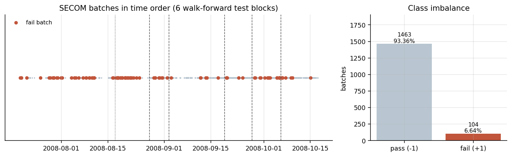
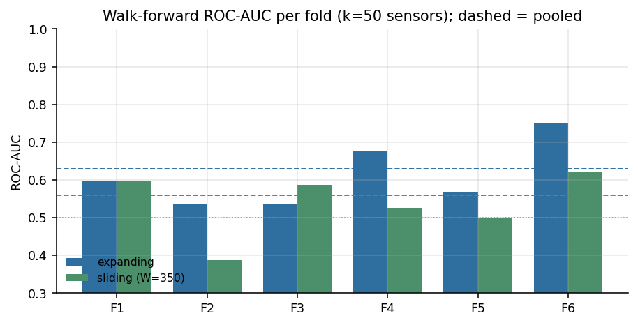
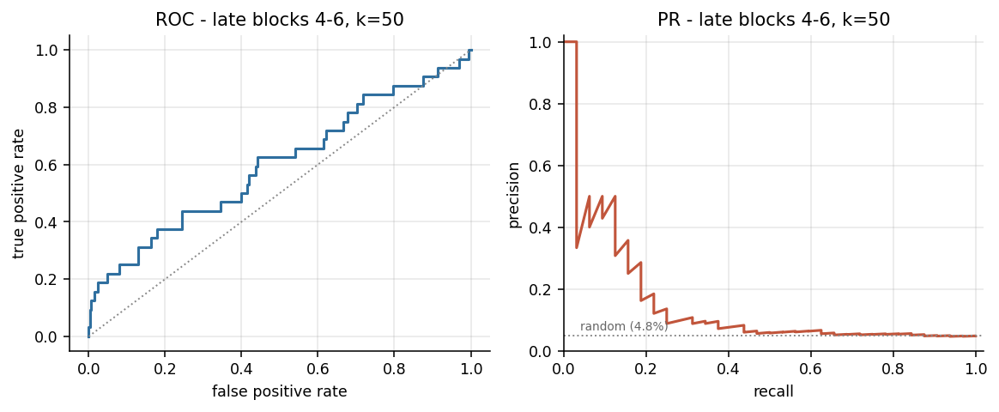
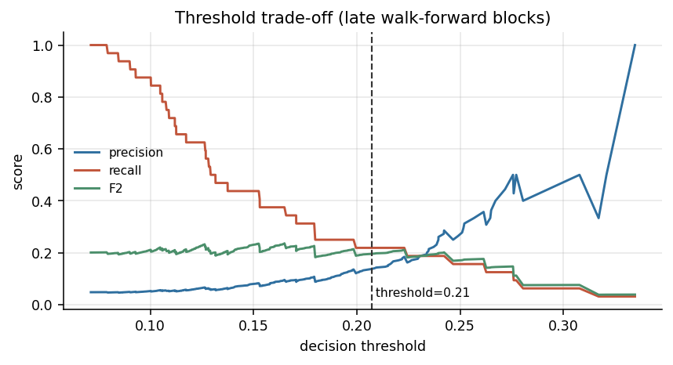
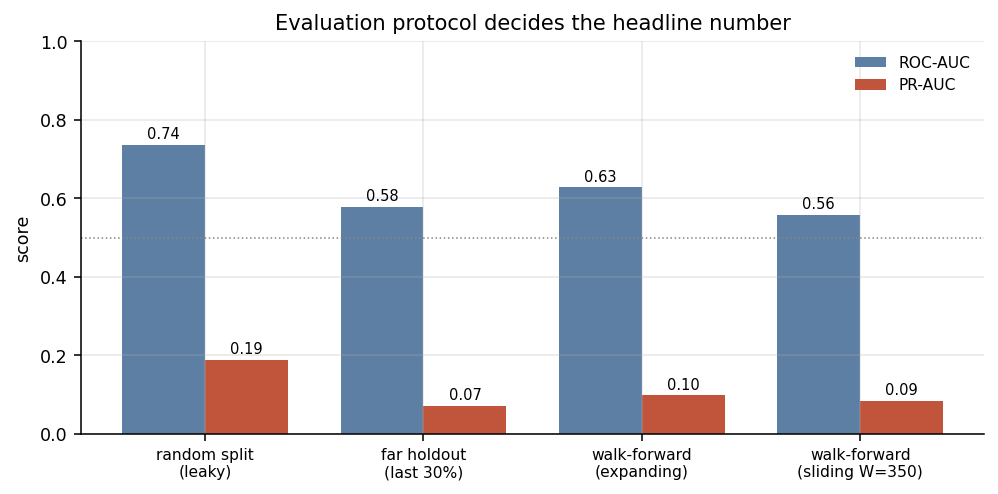
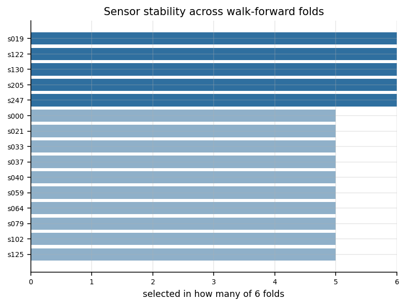
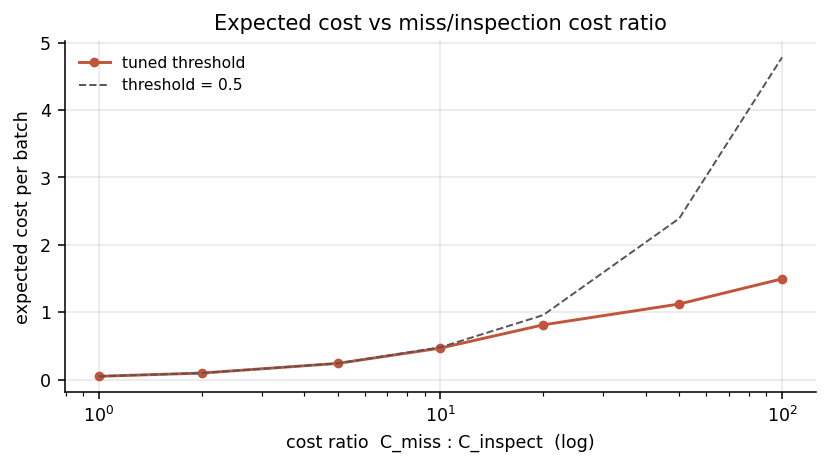

# SECOM 晶圆缺陷批次识别：以评估协议为中心的可复现实验

**一句话摘要**：本项目在 UCI SECOM 半导体产线数据上做的不是"刷分"，而是一次评估协议实验——用 6 折 expanding-window walk-forward（每折内部重跑全部预处理）测出模型对**未来批次**的真实水平约为 ROC-AUC 0.60，而同一套流程换成随机切分就能拿到 0.7367；这 0.14 的差距就是切分泄漏的价格。

> 课程：《工业大数据技术课程设计》｜东华大学 机械工程学院 智能制造工程专业

---

## 先读：口径说明

这些约定贯穿全文，读数字前请先看这一段。

1. **所有指标来自实际运行**。唯一数据源是 `outputs/metrics.json`（一次完整跑通，CPU 约 2 分钟），数字未做任何手工修饰，也没有事后挑折、挑种子。
2. **随机切分与时间外推不是同一个问题**。随机切分回答"同一时期内的批次能不能被分开"，时间外推回答"用过去能不能预测未来"。本项目**只把时间外推的结果当成绩**，随机切分仅作对照。
3. **k 与阈值只用前三折定**。传感器数 k 和决策阈值都只用第 229~898 批（前三折）的折外预测确定；第 898~1567 批（669 批 / 32 个缺陷）作为最终报告集，**只用一次**。
4. **不重采样**。切分前不做 SMOTE、不做任何过采样；类别不平衡只由 `class_weight` 处理。
5. **对照组数字不是成绩**。`0.7367` 是对照协议，用来量化随机切分的虚高幅度，不能当作本项目结果引用。

---

## 数据

| 项目 | 数值 |
|---|---|
| 来源 | UCI Machine Learning Repository，SECOM 数据集（<https://archive.ics.uci.edu/dataset/179/secom>） |
| 规模 | 1567 个批次 × 590 个在线传感器通道 |
| 标签 | -1 良品 / +1 缺陷品；缺陷 104 个（6.64%） |
| 缺失 | 整体缺失率 4.54% |
| 时间跨度 | 2008-07-19 ~ 2008-10-17，批次天然按时间排序（`prepare.py` 里有单调性断言） |

数据是批次级的过程测量：每个批次是一整片晶圆走完一条产线后留下的 590 个在线传感器读数，缺陷标签来自最终电性测试。特征是低信噪比的、强共线的、带缺失的工艺量，不是图像也不是时序波形。

时间顺序是本项目所有设计的前提——同一台设备在不同月份的工况并不相同，因此"随机抽 30% 当测试集"在物理上不成立。

---

## 方法

整条链路是：清洗 → 每折内三级筛选 → 三准则共识排序 → 三模型软投票 → 6 折 walk-forward。

**1. 数据清洗（全量统计，一次性）**

- 丢弃缺失率 > 50% 的列：24 个
- 丢弃常量列：122 个
- 剩 444 个传感器 + 1 个"每批缺失通道数"特征 = **445 维**

**2. 每折内部的三级筛选（只在训练段上估计）**

- 缺失：中位数填补（中位数只取该折训练段）
- 尺度：标准化（均值/标准差只取该折训练段）
- 共线：按列序贪心剔除 `|r| > 0.95` 的冗余通道，实际每折保留 **267~277 维**（约 275）

**3. 三准则共识排序（Borda 平均名次）**

对三个互补视角分别排序，再取名次平均：

- 互信息（捕捉非线性单调关系）
- 随机森林不纯度重要性（400 棵树，捕捉交互）
- 两样本 `|t|` 统计量（线性视角的对照）

三准则一致靠前的通道才进入候选集，降低单一准则的偏置。

**4. 模型：三者概率软投票**

随机森林（500 棵，`min_samples_leaf=2`，`max_features=sqrt`）+ ExtraTrees（同配置）+ 直方图梯度提升（300 轮，`lr=0.05`，`max_leaf_nodes=15`，L2=1.0）。只有 104 个正例，单模型方差大，三个偏差方向不同的模型取平均概率能明显压方差。

**5. 主协议：6 折 expanding-window walk-forward**

`TimeSeriesSplit(n_splits=6)`，第 k 折用前 k 段训练、预测第 k+1 段（每段 223 批）；训练集规模依次为 229 / 452 / 675 / 898 / 1121 / 1344 批。**每一折内部重新跑一遍**填补、标准化、共线剔除、共识排序和三模型训练——这是与"先在全量数据上筛特征再切分"最关键的区别。

---

## 结果

| 协议 | 测试样本 | ROC-AUC | PR-AUC |
|---|---|---|---|
| 随机分层 70/30 × 10 次（对照） | 470 × 10 | 0.7367 ± 0.0404 | 0.1883 ± 0.0358 |
| 单块远期留出（对照） | 470 批 / 26 缺陷 | 0.5795 | 0.0714 |
| expanding walk-forward，pooled（k=50，主协议） | 1338 批 | 0.6287 | 0.0983 |
| sliding W=350，pooled（k=50，对照） | 1338 批 | 0.5588 | 0.0852 |
| **后期块（第 898~1567 批）** | 669 批 / 32 缺陷 | **0.5993**（95% CI 0.482–0.719） | **0.1571**（95% CI 0.065–0.302） |

**逐折 ROC-AUC（k=50）**：0.598 / 0.535 / 0.535 / 0.676 / 0.568 / 0.749，mean-fold 0.6103——折间波动比折间差异大得多，单看某一折会得出完全相反的结论。

后期块正例率 4.78%，PR-AUC 0.157 约为随机基线（正例率）的 **3.3 倍**。

在阈值 0.2072 下（后期块 669 批）：精确率 0.140、召回率 0.219，抓到 7/32 个缺陷批次，误报 43 个，标记率 7.47%。

---

## 关键发现

**1. 随机切分把 ROC-AUC 抬高了约 0.14。** 同一套清洗流程、同一个模型族，随机切分 0.7367，真实时间外推 0.5795~0.6287，后期块 0.5993。这不是模型变差了，而是随机切分让模型在训练时见到了与测试集同期的产线工况。公开资料里 SECOM 上常见的 0.9x 分数，多半来自切分泄漏——随机切分、切分前做 SMOTE/标准化、或者在全量数据上先筛一遍特征再切分。

**2. 滑窗重训练不但没改善，pooled 反而更差（0.5588 vs 0.6287）。** 如果漂移只是"越老的数据越没用"，只用最近 350 批重训练应该更贴合当前工况。结果相反，说明产线发生了**结构性改变**：缺陷的成因机理本身在变，砍掉历史并不能解决问题，反而丢掉了稀有缺陷模式的样本量。

**3. 传感器选择本身是稳定的。** s122、s205、s019、s130、s247 在 6/6 折都被选中；s000、s059、s040、s037、s562 在 5/6 折被选中。跨折一致的工艺信号确实存在，只是信噪比太低——稳定 ≠ 可预测。

---

## 代价敏感分析

产线上漏掉一个缺陷批次的代价，远高于多送一批去复检。定义代价比 `r = 漏检代价 / 单批复检代价`，在前期折外预测上按最小期望代价选阈值，再在后期块上评估（单位代价 = `(r * FN + FP) / N`）。

| 代价比 r | 阈值 | 漏检 FN | 误报 FP | 本方案代价 | 0.5 阈值代价 | 降幅 |
|---|---|---|---|---|---|---|
| 1 | 0.4543 | 32 | 0 | 0.0478 | 0.0478 | 0.0% |
| 2 | 0.4543 | 32 | 0 | 0.0957 | 0.0957 | 0.0% |
| 5 | 0.4094 | 32 | 0 | 0.2392 | 0.2392 | 0.0% |
| 10 | 0.3146 | 31 | 2 | 0.4664 | 0.4783 | 2.5% |
| 20 | 0.2072 | 25 | 43 | 0.8117 | 0.9567 | 15.2% |
| 50 | 0.1013 | 5 | 500 | 1.1211 | 2.3916 | **53.1%** |
| 100 | 0.1013 | 5 | 500 | 1.4948 | 4.7833 | **68.8%** |

两点值得注意。其一，r ≤ 5 时"最优策略是不报警"——单批复检代价相对漏检还不够便宜时，把 32 个缺陷全漏掉反而更省，这解释了为什么 0.5 阈值下模型一个批次都不报（加权训练把概率压得很低）。其二，r=50 时降本 53%，代价是后期块上 527/669（约 79%）的批次被标记——产线要接受 79% 的复检量。这是一笔可以用人力预算算清楚的账。

---

## 图

**图 1 数据总览与类别不平衡**——批次时间轴上的缺陷分布与 6 个测试块切点，右侧是 104 : 1463 的类别比例。



**图 2 逐折 ROC-AUC**——expanding 与 sliding 两种协议的逐折对比，虚线为 pooled 值。



**图 3 后期块 ROC / PR 曲线**——669 批 / 32 缺陷上的两条曲线，PR 曲线上的水平虚线是正例率基线。



**图 4 阈值权衡**——精确率、召回率、F1、F2 随决策阈值的变化，竖线标出 F2 最优的 0.2072。



**图 5 四种协议对比**——同一个模型的分数随评估协议变化，是本项目的主图。



**图 6 传感器稳定性**——每个通道在 6 折中被选中的次数分布。



**图 7 代价比曲线**——期望单位代价随 r 的变化，两条线分别是本方案阈值与固定 0.5 阈值。



---

## 复现

```bash
python data/download.py      # 下载并解压 UCI SECOM 到 data/raw/
python src/prepare.py        # 清洗 + 时间切分，产出 data/processed/secom_clean.npz
python src/run_all.py        # 6 折 walk-forward + 对照协议 + 出图，产出 outputs/metrics.json
```

运行环境：Python 3.11，依赖见 `requirements.txt`（numpy / pandas / scipy / scikit-learn / matplotlib），CPU 即可，整条流水线约 2 分钟。随机种子固定为 `SEED = 20260415`（`src/config.py`），重跑结果可复现。

`src/run_all.py` 会把所有指标写进 `outputs/metrics.json`，控制台日志写进 `outputs/run.log`。文中每个数字都能在 metrics.json 里找到对应字段。

---

## 目录结构

```
secom-yield/
├── README.md                 # 本文件
├── requirements.txt
├── data/
│   ├── download.py           # 下载并解压 UCI SECOM
│   ├── raw/                  # secom.data / secom_labels.data / secom.names
│   └── processed/            # secom_clean.npz（清洗后的时间切分数据）
├── src/
│   ├── config.py             # 路径、随机种子、缺失/共线阈值、测试比例
│   ├── prepare.py            # 读取、清洗、填补/标准化、时间切分
│   ├── screening.py          # 共线剔除 + MI / RF 重要性 / |t| 三准则 Borda 共识
│   ├── models.py             # 模型库与 TimeSeriesSplit 折外预测
│   ├── walkforward.py        # expanding / sliding 两种滚动协议与分块指标
│   ├── evaluate.py           # 指标、F2 阈值、自助法置信区间、代价最优阈值
│   ├── plots.py              # 7 张图
│   └── run_all.py            # 端到端：主协议 + 三个对照 + 出图 → metrics.json
├── figures/                  # fig1 ~ fig7
├── outputs/                  # metrics.json、run.log
└── report/                   # 课程设计报告.md
```

---

## 局限与后续工作

- **样本量是硬约束**：全数据只有 104 个缺陷，测试块只有 26~32 个正例。ROC-AUC 的 95% 置信区间是 0.482–0.719，宽到足以覆盖"没用"和"有用"两种结论，任何单点比较都要打折看。
- **未做在线特征漂移监控**：本文只是把漂移当作误差来源来量化，没有做逐批的分布检验（如 PSI / KS）或漂移告警。工程上这比换模型更重要。
- **未尝试无监督异常检测与半监督**：缺陷只有 6.64%，无监督方法本来就更匹配这种标注稀缺场景，但需要另一套评估口径。
- **未区分隐蔽缺陷（同一批次多种缺陷模式共存）**：把 104 个缺陷当成一类处理，掩盖了不同失效机理可能对应不同传感器子集的事实。
- **后续方向**：按失效模式做多标签拆分；用 PSI 做通道级漂移监控并触发重训；用半监督或 PU learning 利用未标注批次；把 k 也放进嵌套的时间外推里自动选择，而不是固定在前三折。
