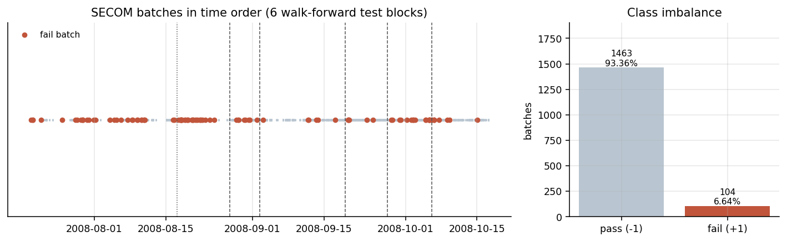
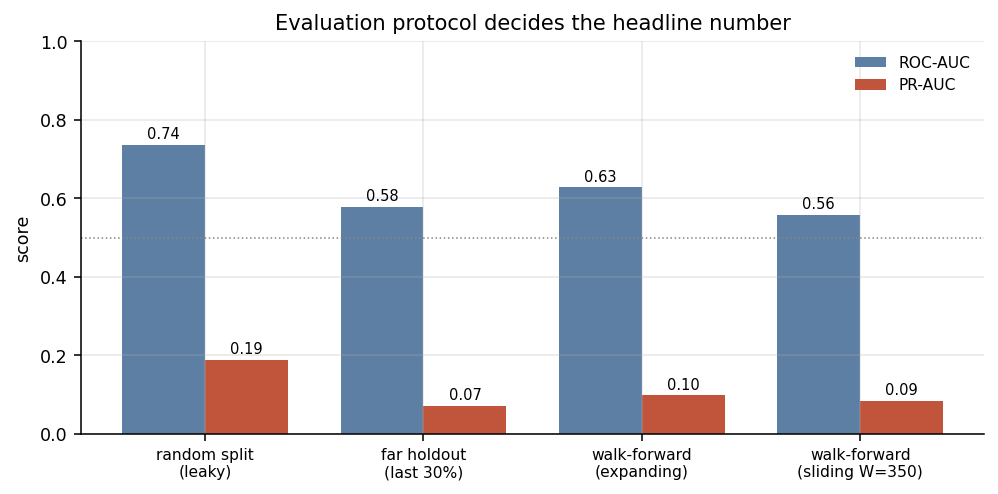
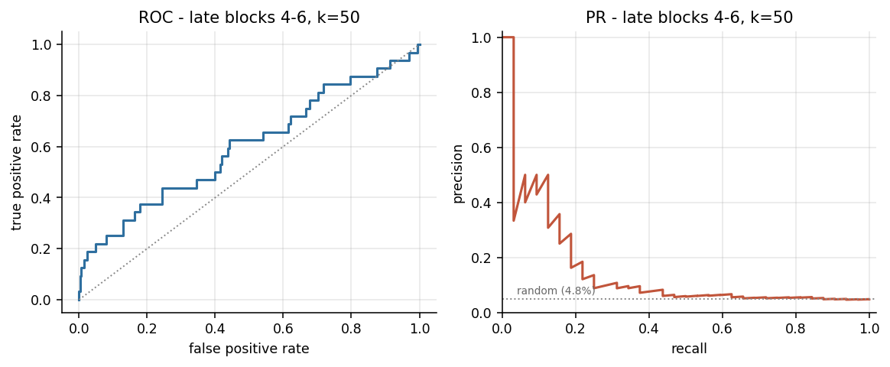
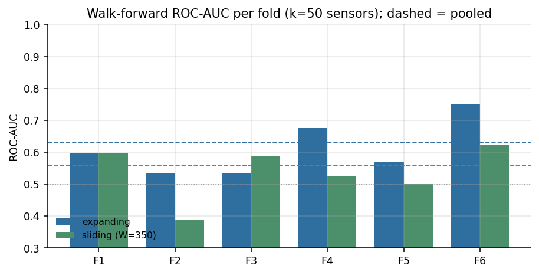
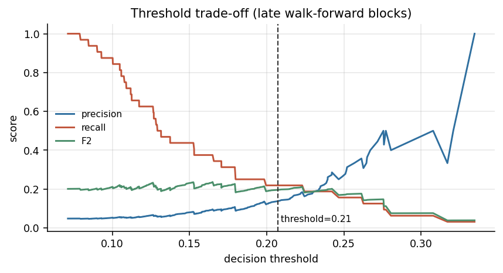
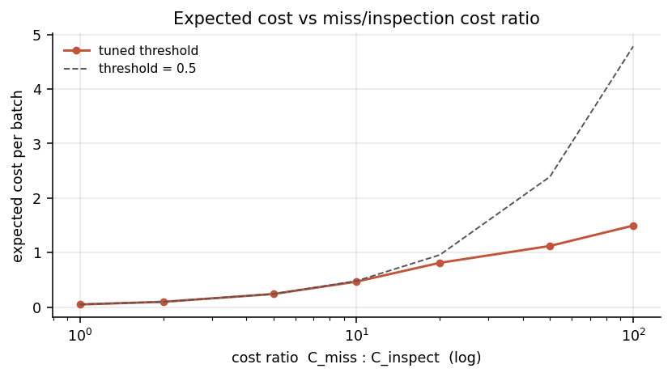
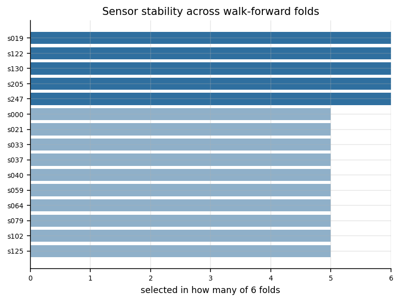

# 面向时间外推的半导体晶圆缺陷批次识别

## ——基于 UCI SECOM 数据集的评估协议研究

**课程**：工业大数据技术课程设计　**专业**：智能制造工程（东华大学 机械工程学院）

---

## 摘要

半导体晶圆制造的缺陷批次早期识别受高维、强共线、严重不平衡与时间漂移四重制约，离线分数与上线表现常差距巨大。本文以 UCI SECOM（1567 批次 × 590 传感器，缺陷 104 个，占 6.64%）为对象，把重心从模型结构转到**评估协议**：6 折 expanding-window walk-forward，每折内部重跑中位数填补、标准化、共线剔除与三准则共识排序，统计量只取自该折训练段；模型为随机森林、ExtraTrees 与直方图梯度提升的概率软投票，不平衡仅用 `class_weight` 处理。后期块（669 批 / 32 个缺陷）ROC-AUC 0.5993（95% CI 0.482–0.719）、PR-AUC 0.1571（0.065–0.302），约为正例率基线的 3.3 倍；同一流程改用随机 70/30 切分可达 0.7367，虚高约 0.14。

**关键词**：SECOM；晶圆缺陷检测；时间外推；评估协议；类别不平衡

---

## 一、问题背景与数据

晶圆走完数百道工序后才由电性测试判定是否合格，此时损失已不可挽回。若能在批次进行中依据在线传感器给出风险分、把高风险批次加严复检，就能把"事后报废"部分转为"事中拦截"——这是典型的少数类检测，而非普通二分类。

数据取自 UCI SECOM（<https://archive.ics.uci.edu/dataset/179/secom>）：某产线 1567 个批次的 590 个在线通道读数，标签 -1 良品 / +1 缺陷，缺陷 104 个（6.64%），整体缺失率 4.54%，时间跨度为 2008-07-19 至 2008-10-17。

三点性质决定建模方式：批次天然按时间排序，同期与后期工况并不相同，这是全部协议设计的前提；共线性极强，同一工位多个通道常测同一物理量的不同侧面，590 维里独立信息远少于 590；信噪比低，缺陷是多种失效机理的混合，正例仅百余个。本文要回答的不是"能否把现有数据分开"，而是"历史批次训练的模型在后续批次上还剩多少判别力"。

## 二、数据预处理与特征筛选

全局清洗只做与标签无关的结构处理：丢弃缺失率 > 50% 的通道 24 个、常量通道 122 个，余 444 个，加上一个"每批缺失通道数"特征（缺失模式本身可能反映设备状态）共 **445 维**，再做中位数填补与 z-score 标准化。

折内筛选是防泄漏的关键，每一步统计量都只在该折训练段上估计：中位数填补；按列序贪心剔除 `|r| > 0.95` 的冗余通道，每折保留 **267~277 维**（约 275）；再对剩余通道做三准则 Borda 共识排序——互信息（非线性单调关系）、随机森林不纯度重要性（400 棵树，捕捉交互）、两样本 `|t|` 统计量（线性视角对照），取平均名次，一致靠前者才入选。候选 k ∈ {20, 50}，由前三折折外 PR-AUC 决定。若先在全量批次上筛特征再切分，测试标签信息已通过筛选渗入特征集合，属典型泄漏式筛选。

## 三、评估协议设计

随机切分在物理上不成立：训练集必然混入测试期之后的批次，等于提前告知答案；它测的是同期插值而非跨期外推，而产线需要的是后者；重复切分每次都含"恰好容易"的测试批次，方差被压低、难例被稀释；任何切分前的全局操作（标准化、填补、SMOTE、特征筛选）都会泄漏。

主协议为 6 折 expanding-window walk-forward：`TimeSeriesSplit` 把时间轴切成 7 段，第 k 折用前 k 段训练、预测第 k+1 段（每段 223 批），训练规模依次为 229 / 452 / 675 / 898 / 1121 / 1344 批；每折内部完整重跑全部预处理，折间不共享统计量，最后拼接折外预测算 pooled 指标（1338 批）。对照为 sliding-window（只用最近 W=350 批）、单块远期留出（前 1097 批训练 / 后 470 批测试，26 个缺陷）、随机分层 70/30 重复 10 次。

**k 与阈值只用前三折定**：取第 229~898 批的折外预测，k 选早期 PR-AUC 最大者（k=50 为 0.1054，k=20 为 0.1025）；阈值取 F2 最大者 0.2072（F2 = 0.3198）。后期块（第 898~1567 批，669 批 / 32 个缺陷）作为最终报告集，只评估一次。指标报 ROC-AUC 与 PR-AUC，阈值化后再报精确率、召回率、F1、F2 与标记率；因正例仅 32 个，关键指标给出 2000 次自助法 95% 置信区间。

## 四、模型与阈值

模型为三者概率软投票：随机森林（500 棵，`min_samples_leaf=2`，`max_features=sqrt`）、ExtraTrees（同配置）、直方图梯度提升（300 轮，学习率 0.05，`max_leaf_nodes=15`，L2=1.0），取 `predict_proba` 的算术平均。正例只有 104 个，单模型方差大，三者偏差方向不同，平均可压低方差。

不平衡只用 `class_weight`，切分前不做任何重采样：SMOTE 在切分前做会把测试邻域信息带进训练集，折内做也只是线性插值，对本就能处理不平衡的树模型收益有限。代价是概率尺度被压缩，多数样本低于 0.1，**固定 0.5 阈值在后期块一个批次都不报警**。故阈值取 F2 最优（beta=2 对应"漏检代价远高于复检"）0.2072。另定义 r = 漏检代价 / 单批复检代价，单位代价 `(r·FN + FP) / N`，对 r ∈ {1, 2, 5, 10, 20, 50, 100} 先在早期折外预测上按最小期望代价选阈值，再到后期块评估。

## 五、实验结果

**表 1　四种评估协议下的指标（k=50）**

| 协议 | 测试样本 | ROC-AUC | PR-AUC |
|---|---|---|---|
| 随机分层 70/30 × 10 次（对照） | 470 × 10 | 0.7367 ± 0.0404 | 0.1883 ± 0.0358 |
| 单块远期留出（对照） | 470 批 / 26 缺陷 | 0.5795 | 0.0714 |
| expanding walk-forward，pooled（主协议） | 1338 批 | 0.6287 | 0.0983 |
| sliding W=350，pooled（对照） | 1338 批 | 0.5588 | 0.0852 |
| **后期块（第 898~1567 批）** | 669 批 / 32 缺陷 | **0.5993**（0.482–0.719） | **0.1571**（0.065–0.302） |

逐折 ROC-AUC（expanding，k=50）为 0.598 / 0.535 / 0.535 / 0.676 / 0.568 / 0.749，mean-fold 0.6103；折间波动远大于协议之间的差异，只看单折会得出相反结论。

后期块正例率 4.78%，PR-AUC 0.1571 约为该基线的 **3.3 倍**，排序信息真实存在，但绝对水平不高。阈值 0.2072 下精确率 0.140、召回率 0.219，抓到 7/32 个缺陷批次，误报 43 个，标记率 7.47%——每 7 个送检批次约有 1 个真缺陷，以约 7.5% 的复检量换回 22% 的拦截率。

**表 2　代价敏感阈值（后期块，单位代价 = (r·FN+FP)/N）**

| r | 阈值 | FN | FP | 本方案 | 0.5 阈值 | 降幅 |
|---|---|---|---|---|---|---|
| 1 | 0.4543 | 32 | 0 | 0.0478 | 0.0478 | 0.0% |
| 2 | 0.4543 | 32 | 0 | 0.0957 | 0.0957 | 0.0% |
| 5 | 0.4094 | 32 | 0 | 0.2392 | 0.2392 | 0.0% |
| 10 | 0.3146 | 31 | 2 | 0.4664 | 0.4783 | 2.5% |
| 20 | 0.2072 | 25 | 43 | 0.8117 | 0.9567 | 15.2% |
| 50 | 0.1013 | 5 | 500 | 1.1211 | 2.3916 | **53.1%** |
| 100 | 0.1013 | 5 | 500 | 1.4948 | 4.7833 | **68.8%** |

r ≤ 5 时"最优策略是不报警"（FN=32、FP=0），与 0.5 阈值下零报警一致。r=20 降本 15.2%，r=50 降本 53.1%，代价是后期块 527/669（约 79%）的批次被标记，复检量从 7.5% 涨到近八成。r=100 与 r=50 阈值相同，因可用阈值已到分数下界。

## 六、讨论

**漂移是结构性的，不是"老数据过期"。** 随机切分 0.7367、真实外推 0.5795~0.6287，差约 0.14，这是同期插值与跨期外推的难度差，不是模型退化。更值得注意的是滑窗：只用最近 350 批重训练，pooled 反而从 0.6287 掉到 0.5588。若漂移只是"越老越不适用"，滑窗应更好；实测更差，说明工况变化不是缓慢连续漂移，而是缺陷成因的**结构性改变**——砍历史等于砍掉稀有缺陷模式的样本量，近期数据又不足以覆盖新模式。这也解释了文献中 0.9 量级的 SECOM 分数为何难以复现：多半来自随机切分、切分前重采样或泄漏式特征筛选。

**0.60 的 AUC 不等于没有价值。** 不平衡场景下 ROC-AUC 0.60 对应 PR-AUC 为基线率的 3.3 倍，排序信息真实存在；配合代价敏感阈值，r=50 时可将期望成本压低 53%。产线要的不是"准确率 95%"，而是"用可承受的复检量换回多少拦截率"。必须交代的是：后期块 ROC-AUC 的 95% CI 为 0.482–0.719，下界已跨过 0.5，单点估计不足以支撑强结论。

**传感器选择是稳定的。** s122、s205、s019、s130、s247 在 6/6 折都被选中，s000、s059、s040、s037、s562 在 5/6 折被选中（图 6）。跨折一致的工艺信号确实存在，共识排序不是随机抖动；但稳定不等于可预测，这些通道效应量小、被噪声淹没。工程含义是：值得对这批通道建立长期漂移监控，而非每季度重做全量筛选。

## 七、结论与局限

**结论**：（1）SECOM 存在严重的跨批次漂移，随机切分把 ROC-AUC 虚高约 0.14，0.9x 量级的文献分数不宜直接采信；（2）滑窗重训练不改善外推，说明漂移是结构性的；（3）传感器选择稳定，存在低信噪比的真实工艺信号；（4）代价敏感阈值在漏检代价高时收益显著（r=50 降本 53.1%），代价是复检量大幅上升，属可权衡的取舍；（5）严格时间外推下该任务的现实水平是 ROC-AUC 0.60 量级、PR-AUC 约为基线 3.3 倍。

**局限**：（1）正例仅 104 个，测试块只有 26~32 个正例，置信区间宽到足以同时容纳"有效"与"无效"；（2）未做在线特征漂移监控（PSI / KS 等逐批检验）；（3）未尝试无监督异常检测或半监督 / PU learning，而这类方法本就更匹配标注稀缺场景；（4）未区分隐蔽缺陷，104 个缺陷被当作同一类，不同失效机理可能对应不同传感器子集；（5）k 固定在前三折选定，未做嵌套式自动选择，存在轻微选择偏差。

## 参考文献

[1] McCann M., Johnston A. SECOM [数据集]. UCI Machine Learning Repository, 2008. <https://archive.ics.uci.edu/dataset/179/secom>

[2] UCI Machine Learning Repository. SECOM 数据集说明（secom.names）：1567 个批次、590 个传感器、-1 / +1 标签定义.

[3] Breiman L. Random Forests. Machine Learning, 2001.

[4] Geurts P., Ernst D., Wehenkel L. Extremely Randomized Trees. Machine Learning, 2006.

[5] Chawla N. V., Bowyer K. W., Hall L. O., Kegelmeyer W. P. SMOTE: Synthetic Minority Over-sampling Technique. Journal of Artificial Intelligence Research, 2002.

[6] Pedregosa F. et al. Scikit-learn: Machine Learning in Python. Journal of Machine Learning Research, 2011.
